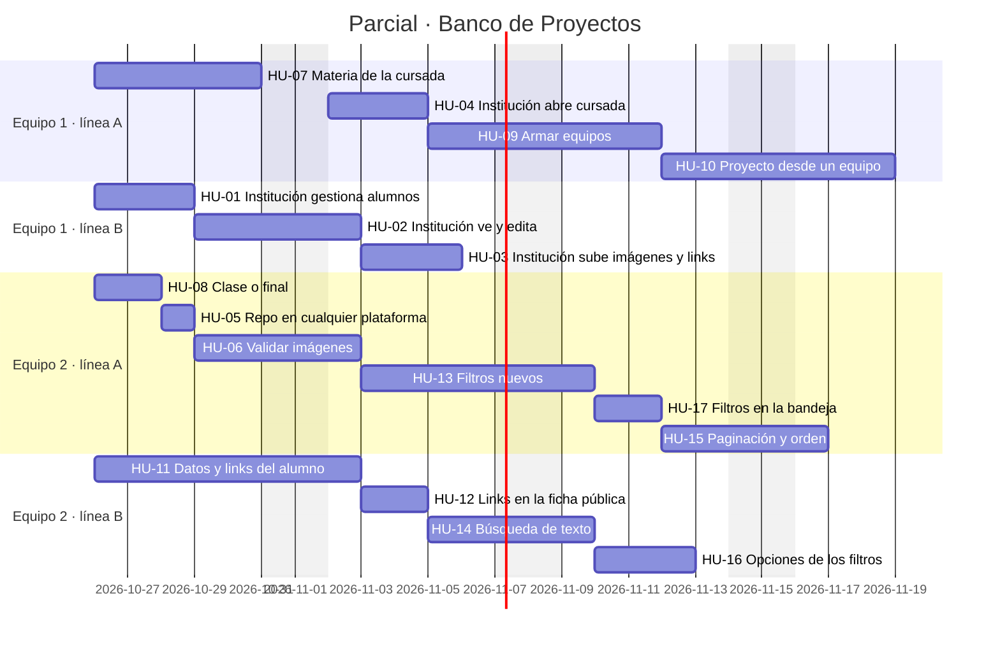

# Banco de Proyectos — Historias de usuario (iteración 2)

Punto de partida: el código de la guía **hasta el paso 43** ("Probar el circuito completo del banco"), o sea las apps `accounts`, `catalogs`, `institutions`, `academics` y `projects` con sus tests. Quedan afuera el seed (44) y Docker (45–47).

Cada historia trae una sección **Hoy** que dice qué existe ya y qué falta, así queda claro que es un ajuste y no algo desde cero. Las rutas de archivos son las del proyecto de la guía.

Las convenciones de la guía siguen valiendo: las lecturas van en `selectors.py`, las escrituras y las reglas en `services.py`, los permisos de objeto en `api.py`, y cada historia cierra con sus tests.

---

## Resumen

| ID | Historia | Épica | Prioridad | Depende de |
|----|----------|-------|-----------|------------|
| HU-01 | La institución gestiona los alumnos de una cursada | Carga por la institución | Alta | — |
| HU-02 | La institución ve y edita los proyectos que cargó | Carga por la institución | Alta | — |
| HU-03 | La institución sube imágenes y links a un proyecto | Carga por la institución | Alta | HU-02 |
| HU-04 | La institución abre una cursada para un docente | Carga por la institución | Media | HU-07 |
| HU-05 | Link al código en cualquier plataforma | Ficha del proyecto | Media | — |
| HU-06 | Validar las imágenes de muestra | Ficha del proyecto | Alta | — |
| HU-07 | Materia de la cursada | Materia y cursada | Alta | — |
| HU-08 | Trabajo de clase o proyecto final | Ficha del proyecto | Alta | — |
| HU-09 | Armar equipos dentro de una cursada | Equipos | Alta | HU-01 |
| HU-10 | Cargar un proyecto a partir de un equipo | Equipos | Alta | HU-09 |
| HU-11 | Editar los datos del alumno y sus links | Alumno | Alta | — |
| HU-12 | Mostrar los links del alumno en la ficha pública | Alumno | Media | HU-11 |
| HU-13 | Buscar por docente, materia, tipo y período | Buscador | Alta | HU-07, HU-08 |
| HU-14 | Búsqueda de texto en todos los datos del proyecto | Buscador | Media | HU-07 |
| HU-15 | Paginar y ordenar los resultados | Buscador | Media | — |
| HU-16 | Opciones para armar los filtros | Buscador | Media | HU-07 |
| HU-17 | Los mismos filtros en la bandeja de la institución | Buscador | Media | HU-13 |

Orden sugerido: HU-07 y HU-08 primero (cambian el modelo y todo lo demás las usa), después la épica de carga por la institución, equipos, alumno y por último el buscador.

---

## Plan del sprint «Parcial» (26/10 → 20/11)

Los tickets de la guía (BACK-1 a BACK-47) quedan todos en el backlog de la materia, sin sprint. El sprint «Parcial» tiene solo estas 17 historias, repartidas en dos equipos que trabajan en paralelo. El reparto sigue al código que toca cada equipo, para pisarse lo menos posible:

| Equipo | Épicas | Código que toca | Puntos |
|--------|--------|-----------------|--------|
| Equipo 1 (`prueba-1`) | Materia y cursada · Carga por la institución · Equipos | sobre todo `academics`, y los endpoints de institución en `projects` | 27 |
| Equipo 2 (`prueba-2`) | Ficha del proyecto · Alumno · Buscador | sobre todo `projects` (modelo, schemas, selectors) | 29 |

Cada equipo trabaja en dos líneas en paralelo, y deja un margen de 2 a 4 días al final para revisión y correcciones.

**Dependencias.** Dentro de cada equipo están anotadas en el tablero y se ven como flechas en el Gantt: HU-02→HU-03, HU-07→HU-04, HU-01→HU-09→HU-10, HU-11→HU-12 y HU-08→HU-13→HU-17→HU-15.

El tablero no admite dependencias entre equipos. La única que hay es **HU-07** (Materia, del equipo 1), que tiene que estar terminada el 30/10, antes de que el equipo 2 empiece HU-13, HU-14 y HU-16. Por eso HU-07 es lo primero del sprint, y esas tres historias lo dicen en su descripción.

**Migraciones.** Durante la primera semana los dos equipos cambian modelos: HU-07 y HU-11 tocan `academics`, y HU-08 toca `projects`. Antes de correr `makemigrations`, hacer `pull` de `main`. Si dos migraciones quedan con el mismo número, resolverlo con `makemigrations --merge` en el mismo PR.

El sprint se carga en el tablero con `scripts/planificar_parcial.py`.

---

## Épica A — La institución carga proyectos

Hoy la institución ya puede crear un proyecto (`POST /api/institution/projects`), y nace aprobado. El problema es que el circuito queda por la mitad: no puede inscribir alumnos, y un proyecto necesita al menos un alumno inscripto en la cursada. Tampoco puede subir imágenes, agregar links ni editar lo que cargó, porque esos endpoints están solo en el `teacher_router`.

### HU-01 — La institución gestiona los alumnos de una cursada

**Como** institución
**quiero** ver e inscribir alumnos en cualquier cursada de mis carreras
**para** poder cargar los proyectos de esos alumnos sin depender del docente.

**Hoy:** `GET/POST/DELETE /teacher/courses/{id}/students` existen solo para el docente (`apps/academics/api.py`). La institución puede listar sus cursadas (`GET /institution/courses`), pero no ve ni carga a los alumnos.

**Criterios de aceptación**
- `GET /api/institution/courses/{course_id}/students` devuelve los inscriptos de una cursada de la institución.
- `POST /api/institution/courses/{course_id}/students` inscribe un alumno con las mismas reglas que hoy: si el email ya existe en la institución se reusa el alumno, y no se puede inscribir dos veces.
- `DELETE /api/institution/courses/{course_id}/students/{enrollment_id}` da de baja la inscripción, con la misma regla de hoy: si el alumno figura en un proyecto de esa cursada, se rechaza.
- Si la cursada es de otra institución, responde **403** (`ensure_course_of_institution`).
- Se reusan `services.enroll_student` y `services.remove_enrollment` sin copiar lógica.

**Tests:** inscribir en una cursada propia, en una ajena (403) y reusar un alumno por email.

### HU-02 — La institución ve y edita los proyectos que cargó

**Como** institución
**quiero** abrir la ficha completa de cualquier proyecto de mis carreras y editarla
**para** corregir datos sin pedírselo al docente.

**Hoy:** la institución lista sus proyectos (`GET /institution/projects`), pero esa lista usa `ProjectSummaryOut`. No hay `GET /institution/projects/{id}` ni `PATCH`.

**Criterios de aceptación**
- `GET /api/institution/projects/{project_id}` devuelve `ProjectOut` en cualquier estado.
- `PATCH /api/institution/projects/{project_id}` acepta `ProjectUpdateIn`.
- Si edita la institución, el proyecto **no** vuelve a PENDING: queda aprobado y firmado por ella, igual que cuando lo crea. Hoy `update_project` siempre recalcula el estado con `_initial_status`, así que el service tiene que recibir un `reviewer` opcional como ya hace `create_project`.
- Si el proyecto es de otra institución, responde **403**.

**Tests:** editar un proyecto propio queda APPROVED con `reviewed_by` igual a la institución; un proyecto ajeno da 403.

### HU-03 — La institución sube imágenes y links a un proyecto

**Como** institución
**quiero** subir capturas y agregar el link al repositorio, la demo o el video
**para** que la ficha quede completa aunque la haya cargado yo.

**Hoy:** `upload_asset`, `delete_asset`, `add_link` y `delete_link` existen solo en `teacher_router` y preguntan por `ensure_project_teacher`.

**Criterios de aceptación**
- Existen los cuatro endpoints bajo `/api/institution/projects/{project_id}/...` con el mismo contrato que los del docente.
- Los services no se duplican: los dos routers llaman a `services.upload_asset` / `services.add_link`.
- El permiso cambia según el actor: el docente de la cursada, la institución de la carrera o el admin.
- Agregar un archivo o un link **no** cambia el estado del proyecto. Así funciona hoy; dejarlo explícito en un test.

**Tests:** la institución sube una imagen a un proyecto propio (200) y a uno ajeno (403); el docente sigue pudiendo hacerlo en los suyos.

### HU-04 — La institución abre una cursada para un docente

**Como** institución
**quiero** crear una cursada indicando materia, docente, año y período
**para** cargar proyectos de comisiones que el docente todavía no abrió (por ejemplo, proyectos finales de años anteriores).

**Hoy:** solo el docente crea cursadas (`POST /teacher/courses`), y el docente queda como `request.auth`.

**Criterios de aceptación**
- `POST /api/institution/courses` recibe `career_id`, `subject_id` (HU-07), `teacher_id`, `name`, `year` y `term`.
- El docente tiene que tener una membresía **aceptada** en la institución. Si no la tiene, responde 400 con el error en `teacher_id`.
- La carrera tiene que ser de la institución. Si no lo es, responde 403.
- Se mantiene la restricción de cursada única por carrera, año, período y nombre.

**Tests:** crear para un docente aceptado; un docente pendiente o de otra institución se rechaza.

---

## Épica B — Ficha del proyecto

### HU-05 — Link al código en cualquier plataforma

**Como** docente o institución
**quiero** cargar el link al código aunque no esté en GitHub
**para** no dejar afuera trabajos que están en GitLab, Bitbucket u otra plataforma.

**Hoy:** `Project.clean()` rechaza cualquier `repository_url` que no sea de `github.com`.

**Criterios de aceptación**
- Se aceptan `github.com`, `gitlab.com` y `bitbucket.org`. La lista vive en `settings` (`ALLOWED_REPOSITORY_HOSTS`), no en el modelo.
- La URL tiene que ser `https://`.
- Otro dominio responde 400 con el mensaje en `repository_url`, y el mensaje lista los dominios aceptados.
- Se actualiza el test que hoy verifica que solo GitHub es válido.

> **A confirmar:** ¿lista cerrada de dominios o cualquier URL `https`? Si es cualquiera, la historia se reduce a validar el esquema.

### HU-06 — Validar las imágenes de muestra

**Como** institución
**quiero** que solo se acepten imágenes reales y de un tamaño razonable
**para** que el disco no se llene de cualquier cosa y la ficha nunca muestre una imagen rota.

**Hoy:** el archivo se guarda en disco (`MEDIA_ROOT/projects/<slug>/<tipo>/<archivo>`) y la base guarda la ruta (`ProjectAsset.file`), que es lo pedido. La validación es floja: solo mira el `content_type` que **declara el navegador**, y eso se puede falsificar. No hay límite de tamaño.

**Criterios de aceptación**
- Las imágenes se validan abriéndolas con Pillow (ya está en `requirements.txt`). Si no abre, responde 400.
- Formatos permitidos: JPG, PNG y WEBP. Tamaño máximo configurable en `settings` (por ejemplo 5 MB).
- Máximo de imágenes por proyecto configurable (por ejemplo 10).
- El nombre del archivo en disco no depende de lo que mandó el usuario: se guarda con un nombre único (uuid) y se conserva la extensión. Así se evitan pisadas y caracteres raros.
- La respuesta sigue devolviendo `file_url` absoluta.
- Si es la primera imagen del proyecto y no se mandó `is_cover`, queda como portada.

**Tests:** subir un `.txt` renombrado a `.png` da 400; un archivo arriba del límite da 400; la primera imagen queda como portada.

### HU-08 — Trabajo de clase o proyecto final

**Como** institución
**quiero** marcar si un proyecto es un trabajo de clase o un trabajo de fin de curso
**para** que se pueda buscar uno u otro tipo por separado.

**Hoy:** `Project` no tiene ningún campo que lo distinga.

**Criterios de aceptación**
- Nuevo campo `Project.kind` con choices `CLASS_WORK` ("Trabajo de clase") y `FINAL_PROJECT` ("Trabajo de fin de curso"). Por defecto vale `CLASS_WORK`.
- Viaja en `ProjectCreateIn` y `ProjectUpdateIn`, y sale en `ProjectSummaryOut` y `ProjectOut` con su `kind_label`.
- Un valor inválido responde 400.
- La migración deja los proyectos existentes como `CLASS_WORK`.

---

## Épica C — Materia y cursada

### HU-07 — Materia de la cursada

**Como** docente o institución
**quiero** que la cursada diga de qué materia es
**para** que cada proyecto quede asociado a materia y docente, y se pueda buscar por materia.

**Hoy:** `Course` tiene `career`, `teacher`, `name` (la comisión), `year` y `term`, pero no tiene materia. Lo único que se acerca es el `name` libre de la comisión.

**Criterios de aceptación**
- Nuevo modelo `academics.Subject` (materia) que pertenece a una `Career`. El nombre es único por carrera, sin distinguir mayúsculas, con el mismo criterio que `create_career`.
- `Course.subject` es una FK a `Subject` (PROTECT). La materia tiene que ser de la misma carrera que la cursada; esa regla vive en el service.
- La institución gestiona sus materias: `GET/POST /api/institution/careers/{career_id}/subjects`.
- `CourseIn` pide `subject_id`, y `CourseOut` lo devuelve anidado.
- El proyecto **no** guarda la materia: la expone como property (`project.subject`) que sale de la cursada, igual que hoy pasa con carrera, institución y docente.
- Migración en dos pasos: primero la FK es nullable, después se completa y se vuelve obligatoria. Con los datos de la guía alcanza con una migración de datos que cree una materia "Sin asignar" por carrera.

---

## Épica D — Equipos

Hoy el equipo es solo un texto (`Project.team_name`) y los alumnos se repiten proyecto por proyecto en `ProjectStudent`. Si el mismo grupo entrega tres trabajos, hay que cargar a sus integrantes tres veces, y nada impide que "Equipo 3" tenga integrantes distintos en cada uno.

### HU-09 — Armar equipos dentro de una cursada

**Como** docente o institución
**quiero** armar los equipos de una cursada una sola vez
**para** después colgarles todos los proyectos que hagan durante la cursada.

**Criterios de aceptación**
- Nuevo modelo `academics.Team` (cursada y nombre, nombre único por cursada) y la tabla intermedia `TeamMember` (equipo y alumno), escrita a mano como las demás de la guía.
- Solo pueden ser miembros los alumnos **inscriptos** en esa cursada.
- Un alumno está en **un solo equipo por cursada**. Intentar sumarlo a otro responde 400 y dice en qué equipo está.
- Endpoints para el docente de la cursada y para la institución:
  - `GET /courses/{course_id}/teams`
  - `POST /courses/{course_id}/teams` con `name` y `student_ids`
  - `PATCH /courses/{course_id}/teams/{team_id}` para renombrar o reemplazar miembros
  - `DELETE /courses/{course_id}/teams/{team_id}`, rechazado si el equipo tiene proyectos
- Dar de baja la inscripción de un alumno que está en un equipo se rechaza, con la misma lógica que hoy usa para los proyectos.

> **A confirmar:** ¿un alumno puede cambiar de equipo entre un trabajo y otro de la misma cursada? Si la respuesta es sí, se saca la regla de "un solo equipo por cursada" y el equipo pasa a ser solo un atajo para elegir alumnos.

### HU-10 — Cargar un proyecto a partir de un equipo

**Como** docente o institución
**quiero** elegir un equipo al cargar un proyecto
**para** no tener que volver a seleccionar a los alumnos uno por uno.

**Hoy:** `ProjectCreateIn` pide `team_name` (texto) y `student_ids` (obligatorio, al menos uno).

**Criterios de aceptación**
- `ProjectCreateIn` acepta `team_id` **o** `student_ids`. Mandar los dos o ninguno responde 400.
- Con `team_id`, los alumnos del proyecto son los miembros del equipo en ese momento. Se copian a `ProjectStudent`, para que el proyecto conserve sus autores aunque el equipo cambie después.
- El equipo tiene que ser de la misma cursada del proyecto.
- Sin equipo (trabajo individual o grupo ad hoc) se sigue usando `student_ids`, como hoy.
- `team_name` deja de ser texto libre: `Project.team` es una FK nullable a `Team`, y la respuesta muestra `team` con `id` y `name`.
- Un mismo equipo puede tener **varios proyectos** en la misma cursada, y un docente puede tener varios proyectos por cursada.
- La migración convierte cada `team_name` no vacío en un `Team` de su cursada.

---

## Épica E — Alumno

### HU-11 — Editar los datos del alumno y sus links

**Como** docente o institución
**quiero** cargar el LinkedIn, el GitHub, la página personal o cualquier otro link de un alumno
**para** que quien vea el proyecto pueda contactarlo o ver más de su trabajo.

**Hoy:** `Student` tiene nombre, apellido y email. No hay endpoint para editar un alumno ya creado: solo se lo crea al inscribirlo.

**Criterios de aceptación**
- Nuevo modelo `academics.StudentLink` con alumno, `link_type` (`LINKEDIN`, `GITHUB`, `PORTFOLIO`, `OTHER`), `title` opcional y `url`. La URL es única por alumno, igual que `ProjectLink` en el proyecto.
- Si el tipo es `LINKEDIN`, la URL tiene que ser de `linkedin.com`; si es `GITHUB`, de `github.com`.
- Endpoints (institución, y docente con el alumno inscripto en alguna de sus cursadas):
  - `PATCH /students/{student_id}` para nombre, apellido y email
  - `POST /students/{student_id}/links`
  - `DELETE /students/{student_id}/links/{link_id}`
- Cambiar el email a uno que ya tiene otro alumno de la institución responde 400.
- Al inscribir un alumno (`EnrollStudentIn`) se pueden mandar links opcionales en el mismo pedido.

**Tests:** un docente edita un alumno de su cursada (200) y uno que no tiene (403); un LinkedIn con dominio inválido da 400.

### HU-12 — Mostrar los links del alumno en la ficha pública

**Como** visitante del catálogo
**quiero** ver quién hizo cada proyecto y sus links
**para** llegar a su perfil profesional.

**Hoy:** `ProjectParticipantOut` devuelve `id`, `full_name` y **`email`**, y lo devuelve también en la ficha **pública**, sin token.

**Criterios de aceptación**
- La ficha pública muestra de cada alumno su nombre y sus links (`StudentLink`).
- La ficha pública **no** expone el email. Docente e institución lo siguen viendo en sus endpoints autenticados, con dos schemas distintos.
- `with_related()` precarga los links de los alumnos, para no generar consultas N+1.

---

## Épica F — Buscador

Lo que hoy filtra `ProjectFilters`: `search` (solo título y resumen), `student`, `team`, `institution_id`, `career_id`, `course_id`, `technology_id` y `year`.

Lo que se pidió y falta: profesor, materia, trabajo de clase o fin de curso, y una búsqueda de texto más amplia. Además, hoy la bandeja de la institución no usa los filtros y ninguna lista pagina.

### HU-13 — Buscar por docente, materia, tipo y período

**Como** visitante del catálogo
**quiero** filtrar por profesor, materia, tipo de trabajo, año y cuatrimestre
**para** encontrar, por ejemplo, "los proyectos finales de Back End del IFTS 18 de 2025".

**Criterios de aceptación**
- Filtros nuevos en `ProjectFilters`, cada uno con su método en `ProjectQuerySet`:
  - `teacher_id`
  - `teacher`: texto sobre nombre y apellido del docente
  - `subject_id`
  - `kind`: `CLASS_WORK` o `FINAL_PROJECT`
  - `term`
  - `institution`: texto sobre el nombre de la institución, para buscar "ifts 18" sin conocer el id
- Siguen funcionando los filtros actuales: cursada, IFTS por id, año, carrera, tecnología, alumno y equipo.
- Todos se combinan con AND, igual que hoy en `_apply_filters`.
- `technology_id` acepta varios valores (`?technology_id=1&technology_id=3`) y devuelve los proyectos que usan **cualquiera** de ellos.
- Un `kind` o `term` inválido responde 400; no devuelve una lista vacía en silencio.

**Tests:** un test por filtro nuevo, más uno que combine institución, año, tipo y materia.

### HU-14 — Búsqueda de texto en todos los datos del proyecto

**Como** visitante del catálogo
**quiero** escribir una sola caja de búsqueda
**para** encontrar proyectos sin saber en qué campo está lo que busco.

**Hoy:** `search` mira solo `title` y `summary`.

**Criterios de aceptación**
- `search` busca en título, resumen, descripción, nombre del equipo, nombre y apellido de alumnos, nombre y apellido del docente, materia, carrera, institución y tecnologías.
- No distingue mayúsculas.
- Si se escriben varias palabras, cada una tiene que aparecer en algún campo (AND entre palabras, OR entre campos).
- No devuelve proyectos repetidos (`distinct()`).

> Con SQLite alcanza con `icontains`. Si más adelante se pasa a PostgreSQL, conviene una historia aparte para búsqueda full-text y para ignorar acentos.

### HU-15 — Paginar y ordenar los resultados

**Como** visitante del catálogo
**quiero** resultados paginados y ordenables
**para** que el catálogo siga respondiendo rápido cuando haya cientos de proyectos.

**Criterios de aceptación**
- Las listas de proyectos (pública, del docente y de la institución) usan la paginación de Ninja (`@paginate`, `limit`/`offset`) y devuelven el total.
- `ordering` acepta `recent` (por defecto), `oldest`, `title` y `year`.
- Un valor de `ordering` inválido responde 400.

### HU-16 — Opciones para armar los filtros

**Como** front-end del catálogo
**quiero** endpoints públicos que listen las opciones de cada filtro
**para** mostrar desplegables en vez de pedirle ids al usuario.

**Hoy:** ya existen `GET /institutions`, `GET /careers` y `GET /technologies`.

**Criterios de aceptación**
- `GET /api/subjects?career_id=&institution_id=`
- `GET /api/teachers?institution_id=`: solo docentes con al menos un proyecto **aprobado**. Devuelve `id` y nombre, sin email.
- `GET /api/courses?institution_id=&subject_id=&year=`: solo cursadas con proyectos aprobados.
- `GET /api/years`: los años que tienen proyectos aprobados, de mayor a menor.
- Ninguna de estas listas filtra datos de cursadas o docentes sin proyectos publicados.

### HU-17 — Los mismos filtros en la bandeja de la institución

**Como** institución
**quiero** usar el buscador completo en mi bandeja
**para** encontrar rápido los pendientes de un docente o de una materia.

**Hoy:** `GET /institution/projects` solo acepta `?status=`.

**Criterios de aceptación**
- La bandeja acepta todos los filtros de `ProjectFilters` además de `status`.
- `status` acepta varios valores (`?status=PENDING&status=CHANGES`).
- Se reusa `_apply_filters`; no se escribe una segunda versión.

---

## Fuera de alcance de esta iteración

- Guardar archivos en un storage externo (S3 o similar). Se sigue guardando en disco y la base guarda la ruta. Tener en cuenta que `static(settings.MEDIA_URL, ...)` en `urls.py` sirve los archivos **solo con `DEBUG=True`**: para producción hará falta nginx o similar (se ve en los pasos de Docker).
- Que el alumno tenga cuenta propia. Sigue siendo un dato que cargan el docente o la institución.
- Front-end.

## Definición de terminado (para todas las historias)

- Migraciones creadas y aplicables sobre una base con los datos de la guía.
- Reglas en `services.py`, lecturas en `selectors.py`, permisos de objeto en `api.py`.
- Admin de Django actualizado para los modelos nuevos.
- Tests nuevos en el `tests.py` de la app, y los tests del paso 43 siguen pasando (adaptados donde la historia cambia el comportamiento, por ejemplo HU-05 y HU-10).
- Los endpoints nuevos aparecen documentados en `/api/docs`.
